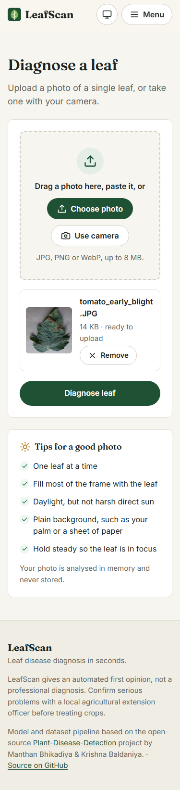
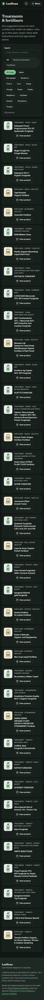

# LeafScan

**Leaf disease diagnosis in seconds.** Photograph a single leaf; LeafScan names the most likely of
26 diseases across 14 crops, says how confident it is, and gives practical next steps.

Powered by an **ensemble of two hybrid CNN-Transformers (CAFormer-S18 at 224 px and 288 px)**
fine-tuned on lab *and* field photos:

| Held-out test set | Accuracy | Macro recall |
|---|---|---|
| PlantVillage lab photos (10,937, leaf-grouped split, no leakage) | **99.63%** | **99.53%** |
| PlantDoc real field photos (225) | **71.1%** | **70.4%** |

Details, per-class numbers and caveats: [DECISIONS.md](DECISIONS.md#hybrid-model-caformer-s18).


<p>
  
  
  
</p>

## Features

- **Mobile-first diagnosis**: choose a photo, drag and drop, paste from the clipboard, or use the
  live camera (back camera on phones). Photos are resized in the browser to 1024 px before upload.
- **Honest results**: top-1 condition with its confidence, a top-3 bar chart, and a warning when the
  model is less than 80% sure.
- **Care steps** for each condition (or growing tips for healthy plants) and one suggested product.
- **Treatments page** with instant search, crop filter and treatment/fertiliser toggle.
- **Works without JavaScript** (plain form), keyboard-accessible, light/dark theme, print stylesheet.
- **JSON API** at `/api/predict` and a health check at `/healthz`.
- **Private by design**: uploads are processed in memory and never written to disk.
- No CDNs, no frameworks: Flask + Jinja, one CSS file, small vanilla JS files.

## Quick start (Windows PowerShell)

```powershell
cd Plant-Disease-Detection-main
py -3.13 -m venv .venv            # Python 3.11+ works; use whichever you have
.\.venv\Scripts\Activate.ps1
pip install -r "Flask Deployed App\requirements.txt"
```

The hybrid models' weights are included (`Flask Deployed App\leafscan_hybrid.pt` and
`leafscan_hybrid_288.pt`, 49 MB each), so the app works straight away. The original project's CNN is still supported: download
`plant_disease_model_1_latest.pt` from its
[Google Drive folder](https://drive.google.com/drive/folders/1ewJWAiduGuld_9oGSrTuLumg9y62qS6A?usp=share_link)
into `Flask Deployed App\` and set `$env:MODEL_KIND = "cnn"`. If the chosen weights are missing, the app
runs in **demo mode** with a banner and random predictions.

```powershell
cd "Flask Deployed App"
flask --app app run               # http://127.0.0.1:5000
```

Debug mode with auto-reload: `$env:FLASK_DEBUG = "1"; flask --app app run`.

## Project structure

```
Flask Deployed App/
  app.py            create_app(): routes, upload validation, security headers, error pages
  config.py         every setting (env-overridable): model path, threshold, upload limit, app name
  model.py          loads the model(s) once; make_transform(), preprocess() and Predictor.predict()
  catalog.py        reads both CSVs once into Condition objects (names, flags, text, product)
  CNN.py            the original network architecture and class list (unchanged)
  wsgi.py, Procfile production entry points
  disease_info.csv, supplement_info.csv
  templates/        base.html, partials/, home, diagnose, result, treatments, about, error
  static/           css/app.css, js/*.js, icons.svg, img/, fonts/, site.webmanifest
  tests/            pytest suite
  leafscan_hybrid.pt, leafscan_hybrid_288.pt  trained hybrid weights (fp16, 49 MB each)
training/           data fetch, split preparation, hybrid training and evaluation
scripts/            make_assets.py, screenshots.py, check_html.py, benchmark.py
screenshots/        375 px and 1440 px, light and dark, every page
DECISIONS.md        why things are the way they are
CODE_WALKTHROUGH.md file-by-file explanation
```

## How a prediction works

1. The photo is validated in memory (extension, Pillow decode, 8 MB limit) and rotated per its EXIF data.
2. It is converted to RGB and prepared twice, exactly as in training: short side 256 px, centre crop
   224 × 224 for the first model; short side 329 px, centre crop 288 × 288 for the second. Both are turned
   into tensors and normalised with ImageNet mean/std.
3. Each hybrid (2 convolution stages, then 2 self-attention stages) scores the photo and its mirror image;
   softmax turns each of the 4 answers into 39 probabilities, and the 4 are averaged.
4. The top 3 classes and their probabilities are looked up in the catalog built from the CSVs.
5. If the best probability is below `CONFIDENCE_THRESHOLD`, the page warns that the model isn't sure.

## Configuration

| Variable | Default | Meaning |
|---|---|---|
| `MODEL_KIND` | `auto` | `hybrid`, `cnn`, or `auto` (hybrid if its weights exist, else CNN) |
| `HYBRID_MODEL_PATH` | `Flask Deployed App/leafscan_hybrid.pt` | 224 px hybrid weights |
| `HYBRID_288_MODEL_PATH` | `Flask Deployed App/leafscan_hybrid_288.pt` | 288 px hybrid weights |
| `ENSEMBLE` | on | `0` = use only the 224 px hybrid (about 190 ms → 70 ms per photo) |
| `TTA` | on | `0` = skip the mirror-image pass (about 2x faster) |
| `MODEL_PATH` | `Flask Deployed App/plant_disease_model_1_latest.pt` | Weights file |
| `REQUIRE_MODEL` | off | `1` = refuse to start without weights (use in production) |
| `CONFIDENCE_THRESHOLD` | `0.80` | Below this, show the "not sure" warning |
| `FLASK_DEBUG` | off | `1` = debugger and auto-reload (never in production) |
| `REPO_URL` | original project | GitHub link in the footer |

The app name, tagline, upload limit (8 MB) and static-file version live in `config.py`.

## Testing

```powershell
pip install -r "Flask Deployed App\requirements-dev.txt"
python -m playwright install chromium        # only for screenshots
cd "Flask Deployed App"; python -m pytest; cd ..
python scripts\check_html.py                 # tag balance, duplicate ids, alt text, inline styles
python scripts\benchmark.py                  # accuracy table + median latency on test_images/
python scripts\screenshots.py                # writes screenshots/ and reports horizontal overflow
```

## Deployment

**Render / Railway (Linux):** set the root directory to `Flask Deployed App`, build command
`pip install -r requirements.txt`, start command from the `Procfile`:

```
gunicorn "app:create_app()" --workers 1 --threads 4 --timeout 60
```

One worker means the model is loaded once (~200 MB RAM); four threads serve requests concurrently.
Put the weights on the server (persistent disk or download at build time) and set `REQUIRE_MODEL=1`.

**Windows server:** gunicorn doesn't run on Windows; use waitress (already in requirements):

```powershell
cd "Flask Deployed App"
waitress-serve --listen=0.0.0.0:8000 --threads=4 --call app:create_app
```

The live camera needs HTTPS (or `localhost`); put the app behind an HTTPS proxy in production.

## Training the hybrid yourself

Needs an NVIDIA GPU (tested on an RTX 3050 6 GB: 72 minutes at 224 px, 117 minutes at 288 px) and about
3 GB of downloads.

```powershell
py -3.13 -m venv .venv-train
.\.venv-train\Scripts\python -m pip install torch==2.9.1 torchvision==0.24.1 --index-url https://download.pytorch.org/whl/cu126
.\.venv-train\Scripts\python -m pip install timm==1.0.20 "huggingface_hub<1.0" scikit-learn pillow
```

1. **Data** into `data\` (git-ignored): PlantVillage colour images + split lists from
   [Hugging Face mohanty/PlantVillage](https://huggingface.co/datasets/mohanty/PlantVillage)
   (`python training\fetch_zip_subset.py <data.zip URL> data\hf_pv color/`, plus `splits/color_train.txt`
   and `color_test.txt` into `data\hf_pv`), [PlantDoc](https://github.com/pratikkayal/PlantDoc-Dataset) into
   `data\plantdoc`, and the `Background_without_leaves` folder of the
   [Mendeley PlantVillage release](https://data.mendeley.com/datasets/tywbtsjrjv/1) into `data\mendeley`.
2. `.\.venv-train\Scripts\python training\prepare_data.py` builds leak-free splits.
3. `.\.venv-train\Scripts\python training\train_hybrid.py` trains the 224 px model and copies the best
   weights into the app.
4. The 288 px model: `$env:TRAIN_SIZE = "288"; .\.venv-train\Scripts\python training\train_hybrid.py
   --name caformer_s18_288 --batch 20 --lr 1.5e-4 --no-copy`, then copy
   `training\runs\caformer_s18_288\best.pt` to `Flask Deployed App\leafscan_hybrid_288.pt`
   (and `Remove-Item Env:TRAIN_SIZE` afterwards).
5. `.\.venv-train\Scripts\python training\compare_models.py` compares 224 / 288 / ensemble on the
   validation sets; `.\.venv-train\Scripts\python training\evaluate.py --runs caformer_s18:224
   caformer_s18_288:288 --name ensemble` prints the test-set tables.

## Research behind the model

- Lab accuracy on PlantVillage is saturated (98-99%+ for many hybrids), e.g.
  [PlantViT and hybrids, Frontiers 2025](https://www.frontiersin.org/journals/plant-science/articles/10.3389/fpls.2025.1522985/full),
  [hybrid CNN-Transformer, Sci. Reports](https://www.nature.com/articles/s41598-025-34406-4),
  [IEEE hybrid CNN-Transformer](https://ieeexplore.ieee.org/abstract/document/11072169/).
- Field photos are the real test: PlantVillage-only models fall to 11-41% on PlantDoc
  ([multi-crop benchmark](https://arxiv.org/pdf/2610.04456), [ConvGeM-next](https://pmc.ncbi.nlm.nih.gov/articles/PMC13201445/),
  [domain-shift benchmark](https://github.com/Jenpoer/plant-disease-detection)); about 68% is the best
  cross-domain figure found ([ViT + mixture of experts](https://www.researchgate.net/publication/393271735_Plant_disease_classification_in_the_wild_using_vision_transformers_and_mixture_of_experts)).
- Mixing in field data, augmentation and pretrained hybrids/ensembles help most
  ([Wiley 2026](https://onlinelibrary.wiley.com/doi/10.1111/jph.70264),
  [ensembles + distillation](https://eprints.whiterose.ac.uk/id/eprint/233495/2/Deployable_Deep_Learning_for_Cross-Domain_Plant_Leaf_Disease_Detection_via_Ensemble_Learning_Knowledge_Distillation_and_Quantization.pdf),
  [MobilePlantViT](https://arxiv.org/pdf/2503.16628)).

## Limitations

- About 71% accuracy on real field photos: always check the confidence; under 80% the app says it isn't
  sure (when it is at least 80% sure on a field photo, it is right about 84% of the time).
- Only the 38 listed leaf conditions are known; anything else is mapped to the closest one.
- Product suggestions and reference photos come from the original project's CSVs and are not verified;
  reference photos are hot-linked and are hidden automatically if their host blocks them.
- An automated first opinion, not professional advice.

## Credit and licence

Model and dataset pipeline based on the open-source
[Plant-Disease-Detection](https://github.com/manthan89-py/Plant-Disease-Detection) project by
Manthan Bhikadiya & Krishna Baldaniya. The original training notebook is in `Model/`.
Fonts: Fraunces and Inter (SIL Open Font License 1.1). Icons adapted from Lucide (ISC).
Crop and product illustrations were drawn for this project (`scripts/make_assets.py`).
Check the original repository's licence terms before redistributing its CNN weights.
Hybrid model: CAFormer-S18 architecture and ImageNet pre-trained weights from
[timm](https://github.com/huggingface/pytorch-image-models) (Apache-2.0; Yu et al., "MetaFormer Baselines
for Vision", 2022), fine-tuned on [PlantVillage](https://github.com/spMohanty/PlantVillage-Dataset)
(Hughes & Salathé, 2015), [PlantDoc](https://github.com/pratikkayal/PlantDoc-Dataset) (Singh et al., 2020,
CC BY 4.0) and the [Mendeley PlantVillage release](https://data.mendeley.com/datasets/tywbtsjrjv/1) (background class).
