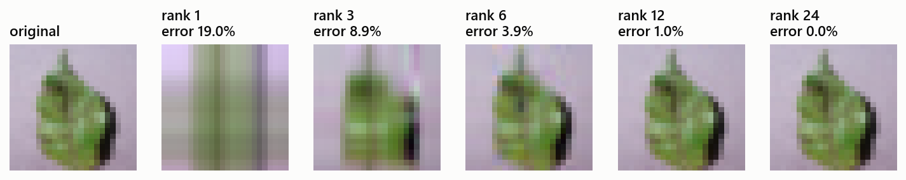
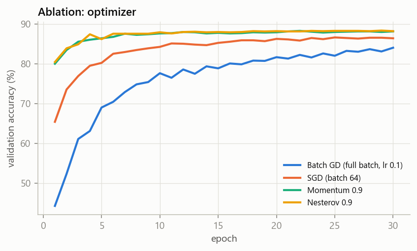
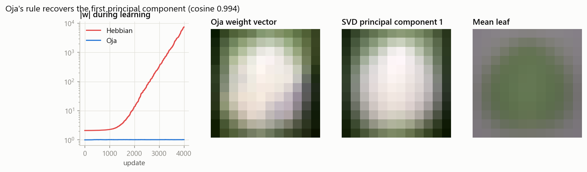
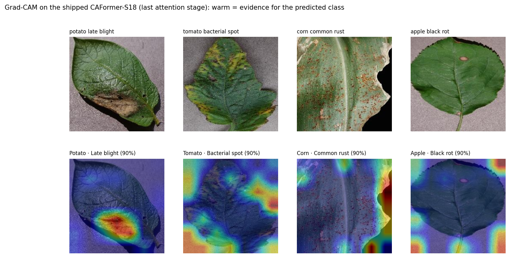
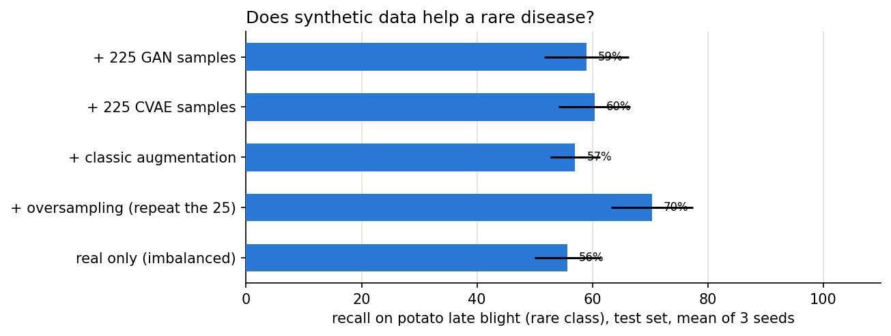
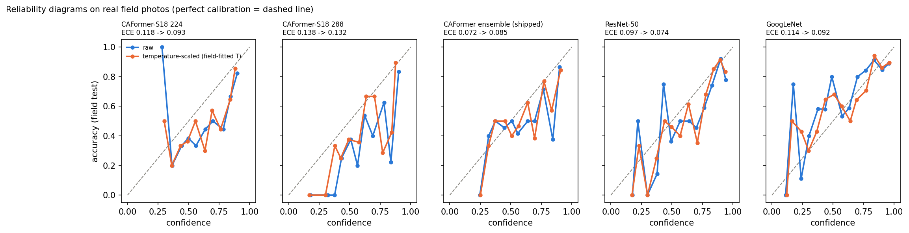
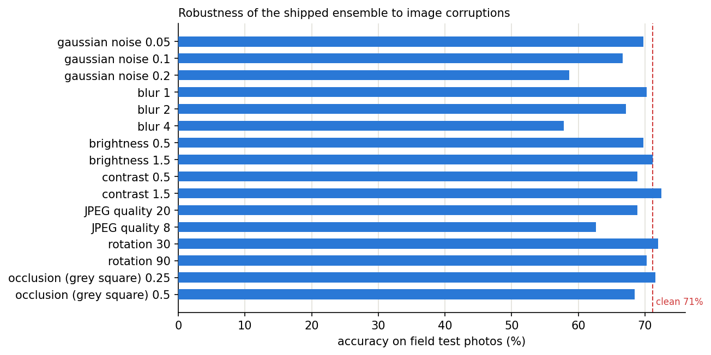

# LeafScan Surveillance: technical report

*Esh Dobhal · Project 05, Crop Disease and Pest Surveillance System (precision agriculture) · November 2026*

**What was built.** A system that turns a phone photo or a scouting video into:
- a disease diagnosis with an honest confidence;
- boxes around diseased leaves and pest damage;
- a per-pixel map of damaged tissue, with severity as a percentage and a grade from 0 to 5;
- a 7-day severity forecast with an action-threshold alert.

It ships three ways:
- the **LeafScan web app** (Flask);
- a **browser version** that runs entirely on the phone ([live](https://eshdobhal.github.io/LEAFSCAN-PLANT-DISEASE-DETECTION/));
- a **surveillance command-line tool** for batches of photos and video.

Behind it sit:
- a NumPy-only fundamentals module, with tests;
- a benchmark of 12 trained models across four vision tasks;
- sequence and generative models;
- an evaluation package that measures everything the brief names.

**Verdict.** **12 of the 14 acceptance tests pass.** Both failures concern lesion-level precision: lesion
IoU is 0.581 against a target of 0.60, and lesion-count F1 is 0.29 against 0.50. The decision (§9) is a
conditional go as a scouting aid, not as a lesion counter.

| Document | Contents |
|---|---|
| [REQUIREMENTS.md](REQUIREMENTS.md) | Use case, stakeholders, the 14 acceptance tests (fixed before training), constraints, brief → evidence map |
| [DATASET_CARD.md](DATASET_CARD.md) | Sources, licences, de-duplication, labels, leakage-safe splits, biases |
| [MODEL_CARD.md](MODEL_CARD.md) | Every model: intended use, measured out-of-scope behaviour, performance, training |
| [USER_GUIDE.md](USER_GUIDE.md) | How to use the browser version, web app and CLI; how to read a report |
| [demo/leafscan_demo.mp4](demo/leafscan_demo.mp4) | Two-minute demo: live site, CLI, pests, forecast, video mode, results |
| [`surveillance/results/EVALUATION_SUMMARY.md`](../surveillance/results/EVALUATION_SUMMARY.md) | Machine-generated tables from the evaluation package |

---

## 1. Problem, users and requirements

Growers and scouts need to know **what** is wrong, **where**, **how bad**, and **whether it is getting
worse**, early enough to act and without waiting days for an expert. The requirements document turns the
six stakeholder groups' needs into 14 measurable acceptance tests (R1–R14). The detection, segmentation,
progression, latency, memory and robustness targets were written **before** those models were trained, so
the go/no-go in §9 cannot have been tuned to the results.

Deployment constraints shape every choice:
- CPU-only inference;
- 1 GB RAM for the web classifier and 2.5 GB for the full pipeline;
- photos never stored;
- redistributable licences only, with AGPL tools allowed as benchmarks;
- a human always makes the spray decision.

## 2. Data (summary of [DATASET_CARD.md](DATASET_CARD.md))

| Task | Data | Train / val / test | Leakage control |
|---|---|---|---|
| Classification | PlantVillage (lab) + PlantDoc (field), 39 classes | 42,029 / 4,824 / 11,162 | official **leaf-grouped** split; PlantDoc official test; 11 cross-split duplicates removed |
| Disease detection | PlantDoc-corrected, 29 classes | 2,095 / 232 / 236 | upstream official test; MD5 checked |
| Pest detection | Tea field photos, 6 classes incl. 2 pests | 2,040 / 269 / 406 | **72% of files were exact duplicates**; de-duplicated before splitting |
| Lesion segmentation | LeafNet75 masks (in-the-wild) | 412 / 88 / 88 | MD5 de-duplicated; seeded split |
| Progression | simulated epidemics (Vanderplank logistic + weather + sprays) | 800 / 100 / 200 fields | split **by field**, never by window |
| Fundamentals / generative | 8-class PlantVillage subset | 2,000 / 480 / 800 | drawn from the leaf-grouped split |

**Field video.** No openly licensed, annotated field video of these diseases could be found. The video
mode is therefore demonstrated on `demo/field_walk_SYNTHETIC.mp4`, a pan-and-zoom across six held-out
LeafNet75 test photos. It is labelled synthetic everywhere it appears.

## 3. Fundamentals module (`fundamentals/`, NumPy only, 29 tests)

### 3.1 Tensor sandbox (brief item 3)

`fundamentals/tensors.py` and `experiments/sandbox.py` work on real leaf photos (24 × 24 × 3):

- **Layouts and strides.** The same 16 photos are shown as `(N,H,W,C) uint8`, `(N,C,H,W) float32` and
  flattened `(N, 1728)`, with their byte strides, to show that reshaping is free and transposing is not.
- **Broadcasting.** Per-channel standardisation broadcasts `(1,3,1,1)` statistics over `(16,3,24,24)`.
  Channel means go to ±1e-5 and standard deviations to exactly 1.
- **Inner products.** The cosine similarity of class-mean photos shows which diseases look alike: potato
  late blight vs corn rust is −0.84, and apple healthy vs potato late blight is +0.66. A matrix product is
  checked against explicit inner products.
- **SVD.** One leaf is reconstructed from rank 1, 3, 6, 12 and 24 (relative error 0.19 → 0.0).
  Across the dataset, 54 of 1,728 directions hold 90% of the energy and 345 hold 99%.
- **Gradient checking.** Central differences against every analytic backward pass give relative errors
  of 7e-12 to 5e-11 for Dense, Sigmoid, Tanh, ReLU, BatchNorm and softmax + cross-entropy.



### 3.2 Neurons and the multilayer perceptron (brief item 4)

- **McCulloch-Pitts units** with hand-set weights and thresholds compute AND, OR and NOT exactly (truth
  tables in `sandbox.json`). XOR needs two layers, which motivates the MLP.
- **Sigmoid neuron** and activations step/sigmoid/tanh/ReLU with derivatives. The maximum derivative of
  sigmoid is 0.25 and of tanh is 1.0, which is why deep sigmoid nets learn slowly.
- **MLP with backpropagation** (`fundamentals/mlp.py`): Dense, Activation, BatchNorm and Dropout layers,
  softmax cross-entropy, and L2. A `RunLog` keeps **parameters** (476,552 learned weights, listed per
  layer) separate from **hyperparameters** (sizes, activation, init, optimiser, lr, batch, epochs,
  regularisation), so every run is reproducible from its log.
- **Baseline:** 1728-256-128-8, ReLU, He init, Momentum 0.9, lr 0.01, batch 64, 30 epochs. Test
  accuracy is **88.25%** on 800 held-out photos (8 classes). The largest confusions are potato late →
  early blight (10 photos), apple healthy → tomato healthy (7) and apple scab → potato late blight (7).

### 3.3 Optimisation and regularisation ablations (brief item 5)

Validation accuracy, mean ± std over 3 seeds (`fundamentals/results/mlp_ablations.json`):

| Study | Variant → validation accuracy (generalisation gap) | Finding |
|---|---|---|
| Optimiser | Batch GD 0.841 (0.105) · SGD 0.864 · **Momentum 0.881** · **Nesterov 0.882** | Mini-batches beat full-batch; momentum adds ~2 points; Nesterov ≈ Momentum here |
| Initialisation (4-layer net) | zeros **0.129** · normal(0, 0.01) 0.797 · **Xavier 0.883** · He 0.879 | Zeros never break symmetry (chance = 0.125); tiny normal init shrinks signals through depth |
| Normalisation | raw pixels 0.843 · standardised 0.881 · **+ BatchNorm 0.913** | BatchNorm gives the largest single gain (+3.2) and a smaller gap |
| Regularisation (40 photos/class) | none 0.777 (gap 0.223) · L2 0.779 · dropout 0.783 · **augmentation 0.813 (0.187)** · all three 0.806 | Augmentation is the only strong regulariser at this size; stacking them does not add up |
| Training-set size | 20/class 0.694 (gap 0.306) · 50: 0.768 · 100: 0.836 · 250: **0.881 (0.118)** | More data shrinks overfitting more than any regulariser |
| Activation | sigmoid 0.881 · tanh 0.881 · ReLU 0.881 | Equal at this depth with the right init; sigmoid fits training data less (0.956) |



### 3.4 Learning rules (brief item 6; `fundamentals/hebbian.py`)

| Rule | Experiment on leaf photos | Result |
|---|---|---|
| Hebbian | Δw = η·y·x on centred photos | ‖w‖ grows 2.1 → 7,471 in 2 epochs: unstable without decay |
| Modified Hebbian (Oja) | adds −η·y²·w | ‖w‖ → 1.02, **cosine 0.994 with the first principal component** from SVD |
| Competitive (winner-take-all) | 8 prototypes, farthest-point seeding (avoids dead units) | distortion 11.7 → 6.2; purity 0.365: clusters follow colour and texture, not disease names |
| Error-correction | perceptron and delta (LMS) rule, healthy vs diseased | **90.7%** validation vs 74.1% majority baseline; perceptron mistakes 456 → 221 per epoch |
| Boltzmann | RBM, 256 visible / 64 hidden, CD-1 | reconstruction error 0.195 → 0.077; free energy of real leaves −220 vs noise −111 (real leaves are more probable) |



## 4. Vision pipeline (brief items 7 and 8)

### 4.1 Classification

The shipped classifier is an ensemble of two **CAFormer-S18** networks (convolution in early stages,
self-attention in later stages), at 224 and 288 px, with mirror test-time augmentation. For the
benchmark, **ResNet-50** and **GoogLeNet** were trained with the identical recipe
(`training/train_hybrid.py --arch`).

| Model | Params | Lab accuracy | Field accuracy | Field macro F1 | ≥ 80% sure | Accuracy when sure |
|---|---:|---:|---:|---:|---:|---:|
| **CAFormer ensemble (shipped)** | 48.8 M | **99.63%** | 71.11% | 0.693 | 63% | 83.7% |
| ResNet-50 | 23.6 M | 99.42% | 70.67% | 0.698 | 61% | 87.6% |
| GoogLeNet | 5.6 M | 96.48% | **72.00%** | **0.708** | 40% | 87.6% |

**Honest reading.** With 225 field photos the 95% interval is about ±6 points, so **no model is
demonstrably better on field photos**. The hybrid does not show a measurable field advantage over a plain
CNN here. The ensemble was selected on validation before testing. It is kept because it gives a confident
answer far more often than GoogLeNet (63% vs 40%) at similar accuracy, and because it is the best model on
lab photos.

### 4.2 Disease and pest detection: RetinaNet with ResNet-50 (main), vs Faster R-CNN and YOLO

All detectors start from COCO weights and are scored with the same COCO-mAP code on the same untouched
test split.

| Dataset | Model | mAP@[.5:.95] | mAP@0.5 | Pest AP@0.5 (mite / bug) | CPU ms / photo | Params |
|---|---|---:|---:|---:|---:|---:|
| PlantDoc, 29 classes | **RetinaNet R50-FPN** | 0.376 | **0.489** | — | 458 | 36.9 M |
| | **Faster R-CNN R50-FPN** | **0.464** | **0.607** | — | 1,069 | 43.4 M |
| | YOLOv8s | 0.430 | 0.550 | — | **17** | 11.1 M |
| Tea, 6 classes | **RetinaNet R50-FPN** | **0.710** | 0.988 | 0.964 / 0.975 | 284 | 36.5 M |
| | Faster R-CNN R50-FPN | 0.694 | **0.989** | 0.972 / 0.977 | 935 | 43.3 M |
| | YOLOv8s | 0.696 | 0.985 | 0.958 / 0.976 | **34** | 11.1 M |

**On PlantDoc, Faster R-CNN wins clearly:** mAP@0.5 0.607, against 0.550 for YOLOv8s and 0.489 for
RetinaNet. Its region-proposal stage helps with the many small, similar leaves in cluttered web photos. **On
tea, the three are within 1.6 mAP points,** and the real difference is speed: YOLOv8s runs at 17–34 ms per
photo on a CPU, RetinaNet at 284–458 ms and Faster R-CNN at 935–1,069 ms.

**What ships.** RetinaNet is the default because:
- the brief specifies "YOLO or RetinaNet with ResNet" for the product;
- it passes R4;
- it is the most accurate detector on tea at strict IoU;
- it is 2.3× faster than Faster R-CNN.

Faster R-CNN is available with `--detector fasterrcnn`. YOLOv8s would be the fastest choice, but its
AGPL-3.0 licence conflicts with the deployment constraint, so it remains a benchmark.

**Lesson.** Had the brief not fixed the detector family, the evidence here favours Faster R-CNN for disease
detection. **R-CNN and Fast R-CNN** are covered by Faster R-CNN, which replaces their external
region proposals (selective search) with a learned region-proposal network. Their two-stage design,
proposals followed by classification of pooled regions, is the "two-stage" row here. The one-stage designs
are RetinaNet (focal loss against easy-background imbalance) and YOLO.

### 4.3 Damaged-tissue segmentation and instance analysis

| Model | Lesion IoU | Dice | Lesion F1 @ 0.5 | Count MAE | Severity MAE | Grade exact / ±1 |
|---|---:|---:|---:|---:|---:|---:|
| **DeepLabV3-R50** | **0.581** | **0.735** | **0.290** | **2.61** | **4.9 pts** | 71.6% / **87.5%** |
| FCN-R50 | 0.535 | 0.697 | 0.278 | 3.08 | 5.5 pts | 71.6% / 86.4% |
| Mask R-CNN (instances) | mask mAP@0.5 **0.576**, mask mAP 0.250 | | | | | |

**Severity** is lesion pixels ÷ leaf pixels. There are no leaf masks, so the leaf is estimated with an
excess-green index plus the lesion, the same way for truth and prediction. Severity is graded 0–5 at 1, 5,
10, 25 and 50%. DeepLab's atrous (dilated) convolutions keep more spatial detail than FCN, which shows in
every metric. Instance-level counting is the weak point: neighbouring lesions merge or split, so lesion F1
is 0.29.

### 4.4 Seeing the convolutions (brief item 7: 2D/3D)

- **2D by hand.** `conv2d_by_hand` (explicit loops) with Sobel, Laplacian and blur kernels on a leaf. It
  matches SciPy to 4e-16.
- **Inside the trained ResNet-50.** First-layer filters (colour blobs, oriented edges) and feature maps from
  each stage.
- **3D by hand.** `conv3d_by_hand` over a (time × height × width) stack: 8 frames in which a real
  LeafNet75 lesion mask is grown outward from its core (a simulated time-lapse).
  It matches PyTorch to 2.5e-16. A temporal-difference kernel lights up exactly the new damage (IoU 0.73
  with the true newly damaged area), which is the idea behind 3D convolution for video.
- **Grad-CAM** on the shipped CAFormer-S18 (224 px, last stage). The evidence sits on the lesion for late blight, but **largely
  on the background** for bacterial spot, rust and black rot. This is shortcut learning from PlantVillage
  backdrops, and it explains much of the lab-to-field gap.



## 5. Advanced module (brief item 9)

### 5.1 Progression forecasting with an RNN and an LSTM

No public dataset photographs the same diseased plants over a season. Training data are therefore
**simulated** from Vanderplank's logistic disease-progress model (dy/dt = r·y·(1−y)). The infection rate
r depends on weather: a temperature bell around 20 °C, humidity above about 78%, and a boost from rain. A
fungicide spray cuts r by 80% for 7 days. Observation noise matches the **measured** DeepLab severity
error (4.85 points).

The task is to predict the next 7 days of severity from the last 14 days of severity, weather and sprays,
and to say whether severity will cross the 5% action threshold.

| Model | 7-day MAE | Day-7 MAE | Alert F1 |
|---|---:|---:|---:|
| Persistence | 4.64 pts | 7.05 | 0.00 |
| Logistic extrapolation | 8.62 | 14.75 | 0.36 |
| Vanilla RNN (tanh) | 1.94 | 2.81 | **0.761** |
| **LSTM** | **1.68** | **2.39** | 0.744 |

The LSTM's gates (sigmoid input, forget and output gates, plus a tanh candidate) are plotted over one test
epidemic in `progression_lstm_gates.png`. Averaged over the test set the sigmoid gates sit near 0.5
(input 0.50, forget 0.48, output 0.50) and the tanh candidate near 0, so each step mixes old and new state.
The RNN, with no gates, is almost as accurate over this short 14-day window. Gates matter more for longer
memory.

### 5.2 GAN and VAE augmentation, latent space

Setup: potato late blight is cut to 25 training photos while 7 other classes keep 250 (64 px). A
**conditional VAE** and a **conditional DCGAN** are trained only on that imbalanced set. A small CNN is
then trained five ways (3 seeds each): real only, + oversampling, + classic augmentation, + 225 VAE
leaves, and + 225 GAN leaves.

| Training set (3 seeds) | Macro F1 | Late-blight recall |
|---|---:|---:|
| Real only (imbalanced) | 0.933 | 0.557 ± 0.057 |
| **+ oversampling** | **0.955** | **0.703 ± 0.071** |
| + classic augmentation | 0.934 | 0.570 ± 0.043 |
| + 225 VAE leaves | 0.942 | 0.603 ± 0.062 |
| + 225 GAN leaves | 0.934 | 0.590 ± 0.073 |

**Synthetic leaves did not beat simply repeating the 25 real photos.** The VAE and GAN gains (+3–5 points)
are within one standard deviation, while oversampling adds 15 points.

The figures show why:
- **Classifier check.** A classifier trained on real photos recognises 0% of the synthetic leaves as late
  blight.
- **VAE samples** (`generative_minority_comparison.png`) are blurry leaf shapes without lesions: the pixel
  reconstruction loss averages out exactly the small dark lesions that define the disease.
- **The conditional GAN mode-collapsed** on the rare class: every one of its late-blight samples is the
  same image, a classic failure with 25 examples.
- **Latent space** (`generative_latent_space.png`, PCA and t-SNE of the VAE means of test leaves): the
  codes still cluster by class although the VAE is conditioned on the class. Some class information leaks
  into the latent code instead of being carried by the label. Interpolating between two leaves changes the
  lighting and background colour smoothly
  (`generative_interpolation.png`).

**Conclusion.** With a few dozen photos of a rare disease, oversampling is the cheap, effective baseline.
Generative augmentation needs more data per class, or stronger models (diffusion, or a generator
pre-trained on many leaves), before it pays off.



### 5.3 Step, sigmoid and tanh

These appear in three places:
- the activation study (§3.3);
- the McCulloch-Pitts step units (§3.2);
- the LSTM gates (§5.1): sigmoid gates decide how much to keep, and tanh proposes the change.

## 6. Integrated application (brief items 7 and 10)

```
photo / video frame
   ├── classify  CAFormer ensemble ────────────── disease + confidence (+ "not sure" below 80%)
   ├── detect    RetinaNet, PlantDoc ──────────── boxes around diseased leaves
   ├── pests     RetinaNet, tea (crop = tea only)  boxes around pest damage
   ├── segment   DeepLabV3 ────────────────────── damaged-tissue mask → lesions, severity %, grade 0–5
   └── forecast  LSTM (if a field history CSV is given) → 7-day severity, threshold alert
        ↓
   Report (JSON) + annotated image + alerts; exit code 2 if any alert
```

- **CLI:** `python -m surveillance.cli analyze|video|status` (see [USER_GUIDE.md](USER_GUIDE.md)).
- **Video:** every Nth frame is analysed, giving a per-frame timeline of label, confidence, severity, pests
  and alerts.
- **Web app and browser version:** the classification component, for growers. The browser version runs the
  ONNX-exported ensemble with WebGPU or WebAssembly. On all 225 field test photos it gives the same
  diagnosis as PyTorch for 219 (97%).

**A design change forced by evaluation.** The first demo run flagged "red spider mite" on tomato and corn
leaves with 0.94+ confidence. Measured over all 236 PlantDoc test photos (none contain tea pests), **89%
received a false pest alarm**, while 100% of tea test photos containing a pest were caught. The pest model
learned "spots on a leaf", not "pest". The pipeline now runs it **only when the crop is declared as tea**,
and skips the 39-class classifier for tea, which it was never trained on.

## 7. Evaluation package (brief item 10; `surveillance/evaluate_all.py`)

### 7.1 Calibration

Expected calibration error (15 bins) on field photos, before and after **temperature scaling**. A single
temperature T is fitted on validation by minimising negative log-likelihood. The fitting code was first
checked on deliberately mis-calibrated scores, where it recovered T = 2.98, 1.00 and 0.50 as designed.

| Model | Field ECE, raw | After T fitted on field validation | With T fitted on mixed lab + field validation |
|---|---:|---:|---:|
| **CAFormer ensemble (shipped)** | **0.072** | 0.085 (T 0.98) | 0.153 (T 0.80) |
| CAFormer-S18 224 | 0.118 | 0.093 (T 1.04) | 0.198 |
| CAFormer-S18 288 | 0.138 | 0.132 (T 1.05) | 0.212 |
| ResNet-50 | 0.097 | **0.074** (T 1.02) | 0.163 |
| GoogLeNet | 0.114 | 0.092 (T 0.93) | 0.121 |

On lab photos every model is under-confident: lab ECE is about 0.10, falling to 0.003–0.006 after a lab-fitted
temperature. That is the effect of label smoothing on photos the models find easy.

**Two findings:**
1. **The calibration set must match the deployment domain.** The first version of the package fitted one
   temperature on mixed validation photos, three-quarters of them lab photos. It learned to sharpen
   (T ≈ 0.8), and field calibration got about twice as bad. The product sees field photos, so the
   temperature is fitted on field validation photos, and lab photos get their own.
2. **The shipped ensemble is already well calibrated on field photos.** Its raw ECE is 0.072, and
   averaging two networks and two views softens over-confidence. Its fitted temperature is ≈ 1. The small
   rise to 0.085 is within the noise of a 225-photo, 15-bin estimate. R3 passes either way.



Two bugs were found by this package and fixed with tests:
- temperature fitting received inference-mode tensors that autograd refused;
- an unconstrained T could overshoot below zero when nearly every prediction was right. T is now
  exp(log T).

### 7.2 Robustness

Shipped ensemble on the 225 field photos under 16 corruptions: Gaussian noise and blur at three
levels; brightness, contrast, JPEG quality, rotation and grey-square occlusion at two each.

| Corruption (level) | Accuracy | | Corruption (level) | Accuracy |
|---|---:|---|---|---:|
| none | **71.1%** | | contrast ×0.5 / ×1.5 | 68.9% / 72.4% |
| noise σ 0.05 / 0.1 / 0.2 | 69.8% / 66.7% / 58.7% | | JPEG quality 20 / 8 | 68.9% / 62.7% |
| blur 1 / 2 / 4 | 70.2% / 67.1% / 57.8% | | rotation 30° / 90° | 72.0% / 70.2% |
| brightness ×0.5 / ×1.5 | 69.8% / 71.1% | | grey square 25% / 50% | 71.6% / 68.4% |

Mild phone-photo damage (noise σ 0.05, blur radius 1, brightness ×0.5 or ×1.5, JPEG quality 20) costs at most **2.2 points** (71.1% → 68.9%). Rotation, contrast and a grey square over 25% of the photo cost nothing. Heavy noise (σ 0.2) and heavy blur (radius 4) bring it down to 58–59%, and JPEG quality 8 to 63%. The model is most sensitive to losing fine texture (noise, blur, heavy compression),
which is consistent with spots and rings being its main evidence when it is not reading the backdrop.



### 7.3 Latency and memory (CPU, 4 threads)

Each measurement runs in a fresh process on a laptop CPU limited to 4 threads.

| What | Median per photo | Peak memory | Target |
|---|---:|---:|---|
| Web app `/api/predict` (ensemble + TTA) | **194 ms** | **687 MB** | ≤ 1 s; ≤ 1 GB |
| CLI pipeline, all five components | **1.36 s** | **1.74 GB** | ≤ 3 s; ≤ 2.5 GB |

The pipeline's components are timed as follows:
- classify: 200 ms;
- detect: 337 ms (RetinaNet; Faster R-CNN adds about 0.6 s);
- pests: 319 ms;
- segment: 498 ms;
- forecast: 1 ms.

The browser version needs no server at all.

### 7.4 Error analysis

| Error | Where it shows | Cause | Mitigation in the product |
|---|---|---|---|
| Lab → field drop (99.6% → 71%) | all classifiers | PlantVillage backdrops (Grad-CAM), few field photos (2,322) | field photos in training (30% of draws); confidence warning; tips for a plain background |
| Look-alike diseases | field confusion matrix | corn northern leaf blight vs gray leaf spot, potato early vs late blight, tomato bacterial spot vs septoria | top-3 shown; "confirm with an extension officer" |
| 12 classes have no field photos | field recall | PlantDoc lacks them | documented; these are less reliable |
| Weak PlantDoc detection classes | per-class AP | tomato mould 0.06, bell-pepper leaf 0.11, bacterial spot 0.11: small similar spots, ambiguous boxes | boxes are a locator, the classifier names the disease |
| Pest false alarms on other crops | 89% of non-tea photos at 0.40; 69% at the tuned 0.75 | pest data only exist for tea | crop gate (tea only) |
| Studio stock photos misread | 4 of the 12 most confident field mistakes | PlantDoc's test set includes white-backdrop stock photos; the model reads backdrops | tips for a natural, plain background; documented |
| Rust pustules missed by the segmenter | demo, corn rust: 0% severity | tiny lesions, LeafNet75 has few rust-type masks | documented; severity is unreliable for rusts |
| Lab-style photos under-segmented | demo, PlantVillage late blight: 0% | domain shift: masks are in-the-wild | documented |
| Lesion counts | lesion F1 0.29 | merged or split neighbouring lesions | report area and grade, counts only as approximate |
| Forecast misses a third of crossings | alert recall 0.68 | noisy severity input; simulated training data | caveat in every forecast; validate on real series |

### 7.5 Confusion matrices and failure cases (`surveillance/failure_cases.py`)

**Confusion matrices.** The figures are `confusion_field_ensemble.png` (every class present in the field test)
and `confusion_mlp_baseline.png` (the NumPy MLP). The most-confused pairs of all five classifiers are in
`EVALUATION_SUMMARY.md`. The same few pairs dominate for every architecture:
- corn northern leaf blight → gray leaf spot (4–5 photos);
- healthy cherry → healthy apple (4–6);
- tomato mosaic virus → leaf mould (3–4);
- potato early → late blight (3).

These errors come from the data, which look alike at field resolution, not from one model's design. At pixel
level, DeepLabV3 finds 74.7% of lesion pixels with 72.4% precision, and keeps 97.3% of healthy pixels.

**Failure cases**, chosen by rule on the test sets, not by hand:

| Component | Rule | What the failures show |
|---|---|---|
| Classification | the 12 most confident of the 65 field mistakes (23 of the 65 were made at ≥ 80% confidence) | **4 of the 12 are studio stock photos** (alamy, shutterstock) of a single leaf on a white backdrop, which PlantDoc's test set contains; the rest are the look-alike pairs above |
| Segmentation | the 4 test photos with the lowest lesion IoU (0.01–0.33) | faint chlorotic lesions missed (IoU 0.01); dozens of small spots under-segmented (0.12); a shadowed fold taken for a lesion (0.24); a mask that covers the whole leaf while the model marks only the necrotic spots (0.33): partly a labelling convention |
| Detection | PlantDoc photos with the lowest recall at the deployed threshold | RetinaNet finds no correct box on 115 of 236 test photos at threshold 0.40; it struggles most on whole-plant photos with many small, densely labelled leaves |
| Pests out of domain | the strongest false pest alarms on other crops | 100%-confidence "tea mosquito bug" boxes on tomato septoria leaf spot and yellow leaf curl |

The photo galleries are written to `surveillance/results/local_only/` by `python -m surveillance.failure_cases`.
They are not committed, because the photos are web-sourced and several are watermarked stock images; the
file names and labels are in `failure_cases.json`.

**Detection thresholds** are chosen on the validation split (`surveillance/tune_thresholds.py`, best F1):

| Detector | Threshold | F1 |
|---|---:|---:|
| PlantDoc RetinaNet | 0.40 | 0.41 |
| PlantDoc Faster R-CNN | 0.50 | 0.53 |
| Tea pest RetinaNet | 0.75 | 0.95 (0.92 at 0.40) |

At its tuned threshold the pest model still raises false alarms on **69%** of photos of other crops (162 of
236), against 89% at 0.40, so the crop gate stays.

## 8. Responsible use

- **Human in the loop.** It never decides to spray. Every result says it is a first opinion, and the CLI
  returns exit code 2 when there is something to check, not to act on.
- **Honest uncertainty.** "Not sure" appears below 80% confidence, and the confidence itself is calibrated
  (§7.1). Forecasts carry a "simulated training data" caveat.
- **Measured scope limits** instead of assumed ones (MODEL_CARD §3), enforced in code where possible (pest
  crop gate).
- **Privacy.** No photo is stored or logged. The browser version never uploads.
- **Licences.** Only redistributable data and weights are shipped; AGPL YOLO is a benchmark only.
- **Bias.** Mostly North American lab photos and Asian tea photos. Re-measure before using it in a new region.

## 9. Go / no-go against the acceptance tests

| ID | Acceptance test | Measured | Result |
|---|---|---|---|
| R1 | lab macro recall ≥ 95% | 99.53% | **PASS** |
| R2 | field accuracy ≥ 65% and macro F1 ≥ 0.60 | 71.11%, 0.693 | **PASS** |
| R3 | accuracy ≥ 80% when ≥ 80% sure; ECE ≤ 0.10 after scaling | 83.7%; ECE 0.085 (raw 0.072), field-fitted T | **PASS** |
| R4 | PlantDoc detection mAP@0.5 ≥ 0.40 | 0.489 (RetinaNet); 0.607 (Faster R-CNN) | **PASS** |
| R5 | each pest AP@0.5 ≥ 0.50 (tea) | 0.964, 0.975 | **PASS** |
| R6 | lesion IoU ≥ 0.60; grade within ±1 for ≥ 85% | IoU **0.581**; 87.5% | **FAIL** (IoU 0.02 short) |
| R7 | lesion F1 ≥ 0.50 at IoU 0.5 | **0.290** | **FAIL** |
| R8 | LSTM 7-day MAE ≥ 30% below persistence; alert F1 ≥ 0.70 | 64% lower; 0.744 | **PASS** (simulated data) |
| R9 | accuracy drop ≤ 15 points under mild corruptions | largest drop 2.2 points (JPEG 20) | **PASS** |
| R10 | classifier ≤ 1 s; full pipeline ≤ 3 s (4-thread CPU) | 0.19–0.20 s; 1.36 s | **PASS** |
| R11 | web app ≤ 1 GB; full pipeline ≤ 2.5 GB | 687 MB; 1.74 GB | **PASS** |
| R12 | Grad-CAM available | `convviz.py`, figure above | **PASS** |
| R13 | "not sure" warning, disclaimers, no storage | warning, disclaimer on every result and in the API, nothing written to disk: 3 dedicated tests, 68/68 app tests pass | **PASS** |
| R14 | pinned dependencies, seeds, one-command tests, documented splits | `pyproject.toml` + pinned requirements, fixed seeds in every script, `config.json` for every vision training run (settings of the others in their results JSON), `scripts/check_all.py`, CI, DATASET_CARD | **PASS** |

**Decision: conditional go, as a scouting aid.**

What meets its target and may be used, always with a person deciding:
- classification with honest confidence;
- locating diseased leaves;
- tea pest detection;
- severity graded 0–5;
- the 7-day outlook, as a guide.

Conditions:
1. **Lesion counts are approximate** (R7 failed). Reports lead with damaged area and grade, which are
   reliable to ±1 grade for 87.5% of photos.
2. **Lesion boundaries are 2 IoU points short** (R6). Severity percentages should be read as ±5 points,
   which is the measured error.
3. **Pest detection only on tea,** enforced in code.
4. **The forecaster stays a guide** until it is validated on real season-long data.
5. **Re-measure on a local test set** before deploying in a new region.

**No-go:** lesion counting as a decision input, pest detection on other crops, and any automatic spraying.

### 9.1 Deployment plan

| Phase | Scope | Gate to the next phase |
|---|---|---|
| **0. Now** | Browser version (classification only) public; CLI and weights in release v1.1.0 for scouts and researchers | — |
| **1. Pilot, one season** | 2–3 farms with one extension office, in one region: scouts run the CLI or the web app, and **an extension officer reviews every report** before any action. With the growers' consent, reviewed photos form a local, labelled test set | On ≥ 300 local photos: classification accuracy ≥ 70% with ECE ≤ 0.10; officer agrees with the severity grade (±1) on ≥ 85%; zero actions taken without review |
| **2. Regional roll-out** | More farms and crops of the same region; officer review of a random 10% of reports plus all alerts | Monitoring (below) stays within limits for a full season |
| **3. New crops, pests or regions** | Each needs its own local test set first | Pest detection for a new crop needs box-annotated local pests, AP@0.5 ≥ 0.50 **and** false alarms on non-target crops ≤ 10%. Forecasts become decision inputs only after ≥ 1 season of real severity series with alert F1 ≥ 0.70 |

**Infrastructure.**
- **Web app:** one CPU instance with 1 GB RAM (measured 687 MB; 194 ms per photo).
- **Surveillance pipeline:** a 4-vCPU, 4 GB worker (measured 1.74 GB). At 1.36 s per photo, that is about
  2,600 photos per hour.
- **Browser version:** needs no server.

No photo is stored unless the grower opts in to the pilot's test set.

**Monitoring,** weekly. Each item has an alert condition:
- **Share of "not sure" answers.** On field photos this is 37% today; alert if it rises by 10 points.
- **Officer disagreement rate.** Alert above 30% over the last 100 reviewed reports.
- **Class mix:** a disease suddenly dominating may mean an outbreak or a broken camera.
- **p95 latency.** Alert above 3 s.
- **Errors.** Any crash or failed upload is logged by the CLI (`--log-file`).

**Retraining triggers:**
- an alert that persists for 2 weeks;
- a new disease or pest in the region;
- the start of each season, once new reviewed photos exist.

A retrained model is promoted only if, on the frozen local test set and the original test sets, it passes
`python scripts/check_all.py` and the R1–R14 acceptance tests via `surveillance/evaluate_all.py`, and does
not regress any of them.

**Rollback.** Every model version is a GitHub release with SHA-256 checksums. Returning to the previous
version means pinning `download_weights.py` to the previous release tag; nothing else changes.

**Risks.**

| Risk | Likelihood | Mitigation |
|---|---|---|
| Wrong diagnosis leads to a wrong spray | Medium (about 29% of field answers are wrong) | Human review in phases 1–2; "not sure" warning; disclaimer on every result |
| Domain shift: new region, camera or cultivar | High | Local test set before each phase; monitoring of "not sure" share and disagreement |
| Pest model used outside tea | Prevented in code | Crop gate, documented in the user guide and model card |
| Over-trust in forecasts | Medium | Simulated-data caveat in every forecast; not a decision input until validated |
| Privacy | Low | No storage by default; consented, opt-in pilot data only |

## 10. Limitations and next steps

1. **More real field photos**, the largest lever for classification and detection.
2. **Better lesion boundaries.** Train at higher resolution or with a boundary loss, and add leaf masks so
   severity does not rely on a colour index. This targets the two failed tests, R6 and R7.
3. **Local pest data** for the 14 LeafScan crops before pest detection can leave tea.
4. **Real severity time series** (repeat photos of tagged plants) to validate the forecaster.
5. **Distil** the ensemble and serve a quantised detector for phones.

## 11. Reproducing every number

```powershell
.\.venv-train\Scripts\python -m pip install -r requirements-research.txt
.\.venv-train\Scripts\python training\prepare_data.py
.\.venv-train\Scripts\python -m surveillance.prepare_data
.\.venv-train\Scripts\python -m fundamentals.experiments.sandbox          # and mlp_ablations, learning_rules
bash surveillance/run_experiments.sh                                       # all detection/segmentation/generative runs
.\.venv-train\Scripts\python -m surveillance.progression
.\.venv-train\Scripts\python -m surveillance.convviz
.\.venv-train\Scripts\python -m surveillance.tune_thresholds         # detection thresholds, validation only
.\.venv-train\Scripts\python -m surveillance.evaluate_all            # includes confusion matrices and failure cases
.\.venv-train\Scripts\python scripts\check_all.py --e2e               # build check and every test suite, one command
```

Hardware used: one RTX 3050 Laptop GPU (6 GB) and its CPU. Every script fixes its random seeds; exact
library versions are pinned in `requirements-research.txt`.
